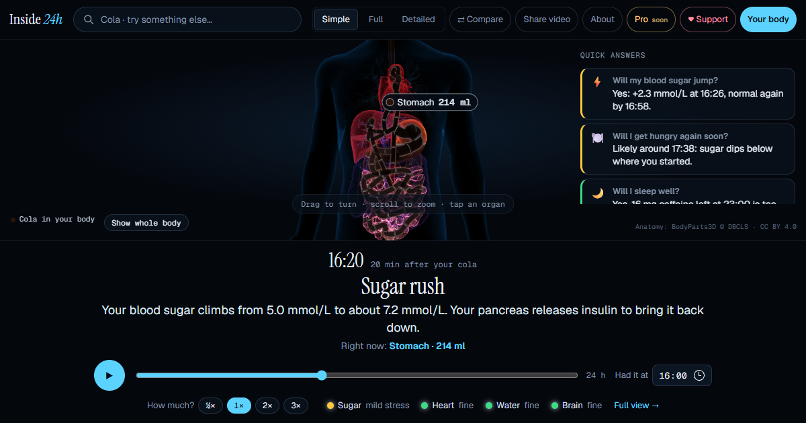

# Inside 24h

**See what happens inside your body in the 24 hours after you eat or drink something.**

Pick a food or drink — cola, espresso, beer, a banana, 149 foods in total — and watch it travel through a real 3D body: where it goes, how long it stays, what enters your blood, and what it does to your sugar, hunger, sleep and hydration, minute by minute.



## Built on evidence, not vibes

Every claim in the app carries an evidence level and a source:

| Level | Meaning |
|---|---|
| **A** | Established — consistent human studies or official bodies (EFSA, FDA, ADA…) |
| **B** | Supported — human studies, but small or highly variable |
| **C** | Our estimate — the calculation and assumptions are shown |
| **?** | Not yet researched — says why and what would need to be measured |

Where people differ, the app shows a range instead of a single number. Simulations are driven by models with parameters from the literature (gastric emptying, first-order absorption pharmacokinetics, glycaemic response) and are covered by automated tests that reproduce published values.

*Inside 24h is not medical advice.*

## Run it

```bash
cd app
npm install
npx vite --config vite.v4.config.ts      # dev server
npx vitest run                           # model tests
npx vite build --config vite.v4.config.ts && node scripts/make-site.mjs   # static site -> /site
```

## Project layout

```
app/src/science   simulation models + tests (Vitest)
app/src/content   claims, sources, organ descriptions
app/src/v4        current interface
pipeline/         anatomy pipeline (BodyParts3D -> glTF)
research/         per-product research dossiers + tools
site/             ready-to-deploy static site
```

## Support

Inside 24h is free. If you want to support it:

**Solana (SOL):** `9GBjH2j66drD89RXGFroxrWN1PFbt7aSUwxYNnDJJtP7`

## Credits

Anatomy: BodyParts3D, © The Database Center for Life Science, licensed under CC Attribution 4.0 International.
Food data: USDA FoodData Central (SR Legacy).
